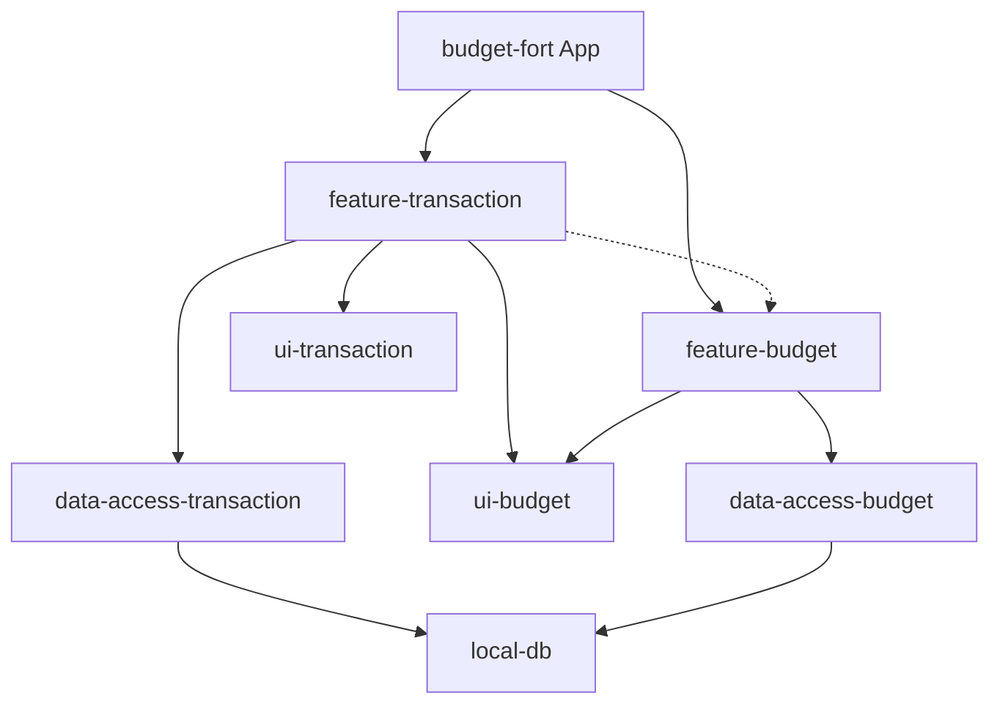
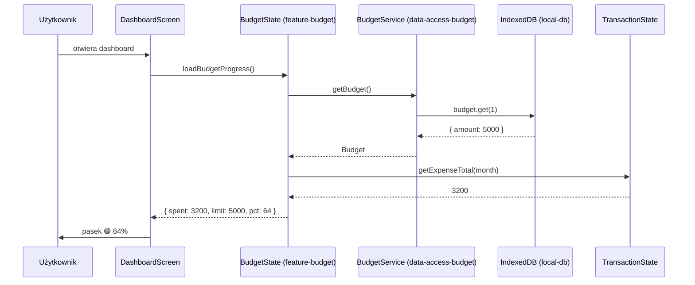

# ADR-001: Osobna domena `budget` w `libs/budget/`

- **Status:** accepted
- **Date:** 2026-10-17
- **Deciders:** aboczula

## Kontekst

Feature "Planowanie budżetu" (`docs/specs/budget/planowanie-budzetu.md`) wprowadza nową domenę biznesową:
budżet ogólny + limity kategorii. Kod musi gdzieś trafić — albo jako rozszerzenie istniejących
libs w `libs/transaction/`, albo jako osobna domena `libs/budget/`.

Istniejąca architektura:
- `libs/transaction/feature-transaction` — dashboard, settings, home screen
- `libs/transaction/data-access-transaction` — CRUD dla Transaction i Category
- `libs/transaction/ui-transaction` — komponenty UI (header, nav drawer)
- `libs/shared/local-db` — IndexedDB (Dexie)

## Decyzja

**Nowy kod dla domeny `budget` trafi do osobnej struktury `libs/budget/`:**

```
libs/budget/
  feature-budget/       # type:feature — strona ustawień /settings/budget, komponenty progresu
  data-access-budget/   # type:data — CRUD dla Budget + CategoryBudget w IndexedDB
  ui-budget/            # type:ui — pasek postępu (budget progress bar)
```

Nowe aliasy w `tsconfig.base.json`:
- `@feature-budget` → `libs/budget/feature-budget/src/index.ts`
- `@data-access-budget` → `libs/budget/data-access-budget/src/index.ts`
- `@ui-budget` → `libs/budget/ui-budget/src/index.ts`

## Rozważane alternatywy

### Alternatywa 1: Rozszerzenie istniejących libs `transaction`

- **Opis:** Nowy kod (serwisy budżetu, komponenty progresu) trafia do istniejących libs:
  `data-access-transaction` (nowe serwisy BudgetService), `feature-transaction`
  (nowy komponent ustawień + rozszerzenie DashboardState).

- **Plusy:**
  - Mniej libs do utworzenia — szybszy start
  - Mniej konfiguracji Nx (project.json, tsconfig paths)
- **Minusy:**
  - Mieszanie domen: budżet nie jest logicznie częścią transakcji
  - Narusza SRP na poziomie modułów
  - DashboardState już ma ~260 linii — dalsze rozszerzanie pogorszy utrzymanie
- **Dlaczego odrzucono:** Budżet to osobny bounded context. Mieszanie go z transakcjami stworzy
  "big ball of mud" w `feature-transaction`. Separacja od początku jest tańsza niż późniejszy refactor.

### Alternatywa 2: Wszystko w `feature-transaction`, osobny data-access

- **Opis:** Feature w `feature-transaction`, ale data-access jako osobne `data-access-budget`.
- **Plusy:**
  - Częściowa separacja — warstwa danych osobno
- **Minusy:**
  - Asymetryczna struktura (feature w transaction, data-access osobno)
  - Nadal miesza UI/feature
- **Dlaczego odrzucono:** Mniej czyste niż pełna separacja. Nie ma powodu robić tego połowicznie.

## Konsekwencje

### Pozytywne

- Czysta separacja domen: `transaction` ≠ `budget`
- Każde lib ma swój tag (`type:feature`, `type:data`, `type:ui`) — zgodnie z ESLint boundary rules
- Łatwa rozbudowa o kolejne funkcje budżetowe (alerty, budżet roczny)
- Równoległa praca nad `budget` i `transaction` bez konfliktów

### Negatywne

- Więcej libs do utworzenia i skonfigurowania (3 nowe project.json + tsconfig paths)
- Więcej barrel files (index.ts) do utrzymania
- Nowa domena wymaga osobnych testów setup

### Neutralne / warte odnotowania

- `local-db` będzie współdzielone — obie domeny używają tej samej bazy IndexedDB. Nowe store'y (`budget`, `categoryBudget`) muszą być dodane do schemy Dexie.
- `feature-budget` będzie importowane przez `budget-fort` (app) jako nowy lazy route.
- Komponenty progresu budżetu będą renderowane na dashboardzie (`feature-transaction`), ale przez komponenty z `ui-budget`.

## Diagramy





## Powiązane

- [Spec: `docs/specs/budget/planowanie-budzetu.md`]
- [Architektura repo: `docs/ai/06-repository-architecture.md`]