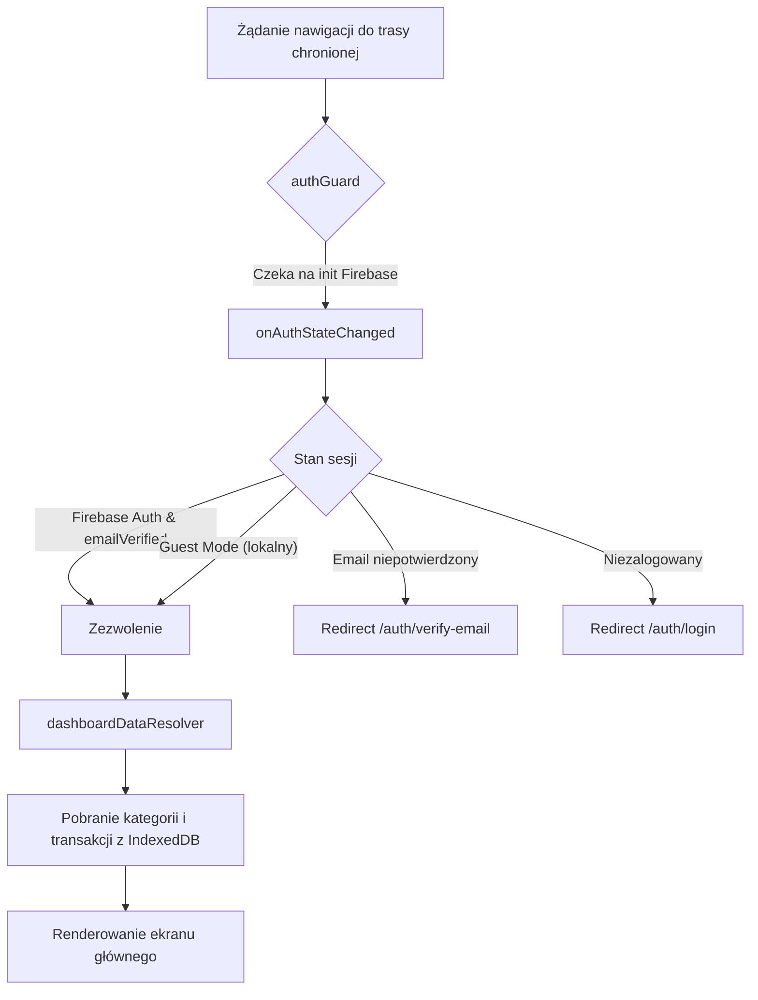

# ADR-002: Domena Auth, integracja z Firebase Authentication i hybrydowy tryb offline

- **Status:** accepted
- **Date:** 2026-11-11
- **Deciders:** Adam, Antigravity (Architect & BA)
- **Supersedes:** —
- **Superseded by:** —

## Kontekst

Aplikacja Budget Fort do tej pory działała wyłącznie lokalnie w przeglądarce bez mechanizmu logowania i tożsamości użytkownika. Pojawiła się potrzeba wprowadzenia uwierzytelniania:
1. Logowanie kontem Google (OAuth popup).
2. Logowanie i rejestracja adresem email i hasłem z wymogiem weryfikacji maila przez Firebase.
3. Zachowanie pełnej dostępności aplikacji dla użytkowników chcących pozostać anonimowi (tryb lokalny / gość).
4. Ochrona tras prywatnych przez Route Guard.
5. Przygotowanie danych IndexedDB przed załadowaniem dashboardu za pomocą Data Resolvera.

Wymaga to ustalenia struktury bibliotek w monorepo Nx, modelu stanu sesji (Signals) oraz strategii współistnienia Firebase Auth z architekturą offline-first i IndexedDB.

## Decyzja

1. **Struktura bibliotek w Monorepo Nx:**
   Tworzymy nową domenę `libs/auth/` z podziałem zgodnym ze standardem Nx i Budget Fort:
   - `libs/auth/data-access-auth`: integracja z Firebase Auth SDK (modular v13), `AuthService`, sygnałowy stan sesji `AuthState`, obsługa `browserLocalPersistence`.
   - `libs/auth/feature-auth`: komponenty widoków routingu (`LoginComponent`, `RegisterComponent`, `VerifyEmailComponent`), `authGuard`, `dashboardDataResolver` oraz definicja tras `featureAuthRoutes`.
   - `libs/auth/ui-auth`: prezentacyjne komponenty formularzy, przyciski logowania Google oraz układ kart autoryzacji zgodny z Angular Material i BEM.

2. **Model tożsamości i stan sesji (Signals):**
   - Stan autentykacji jest reaktywny (`Signal<AuthStateModel>`).
   - Użytkownik może znajdować się w stanie:
     - `authenticated` (zalogowany przez Firebase, a w przypadku email/password: `emailVerified === true`).
     - `guest` (wybór "Używaj lokalnie", flaga zapisywana w `localStorage`).
     - `unauthenticated` (brak aktywnej sesji lub w trakcie weryfikacji maila).
     - `loading` (stan inicjalny oczekiwania na `onAuthStateChanged`).

3. **Ochrona tras i Data Resolver:**
   - `authGuard` chroni trasy aplikacji: dopuszcza tylko stany `authenticated` i `guest`. W przeciwnym razie przekierowuje na `/auth/login`.
   - `dashboardDataResolver` na trasie `/` pobiera wstępne dane z bazy IndexedDB (kategorie i transakcje) przed załadowaniem komponentu widoku.

4. **Weryfikacja email:**
   - Podczas rejestracji przez email wywoływane jest `sendEmailVerification`.
   - Dopóki `user.emailVerified` nie ma wartości `true`, użytkownik nie jest wpuszczany przez `authGuard` na trasy chronione i trafia na ekran `/auth/verify-email`.

## Rozważane alternatywy

### Alternatywa 1: Wymóg logowania dla wszystkich (brak trybu gościa)
- **Opis:** Aplikacja zmusza do logowania przed jakimkolwiek użyciem.
- **Dlaczego odrzucono:** Sprzeczne z założeniem aplikacji domowej i prywatności – użytkownicy chcący trzymać dane wyłącznie lokalnie na swoim telefonie muszą mieć taką możliwość bez przekazywania danych do chmury.

### Alternatywa 2: Logowanie bez weryfikacji adresu email
- **Opis:** Użytkownik rejestruje się i od razu wchodzi do aplikacji bez potwierdzania adresu.
- **Dlaczego odrzucono:** Wymóg biznesowy wyraźnie wskazał konieczność weryfikacji adresu email przez Firebase w celu zapobiegania literówkom i fałszywym kontom.

## Konsekwencje

### Pozytywne
- Czysty podział domenowy w monorepo Nx (`libs/auth/**`), izolujący logikę autentykacji od modułów budżetu i transakcji.
- Pełna obsługa scenariuszy offline (zarówno dla trybu gościa, jak i cachowanej sesji Firebase).
- Płynny UX dzięki prefetchingowi danych przez resolver.

### Negatywne / Do monitorowania
- Konieczność zarządzania stanem asynchronicznym inicjalizacji Firebase Auth podczas pierwszego renderowania (rozwiązane przez stan `loading` w `AuthState` i oczekiwanie w guardzie na zakończenie pierwszego cyklu `onAuthStateChanged`).

## Diagram przepływu Guard & Resolver

