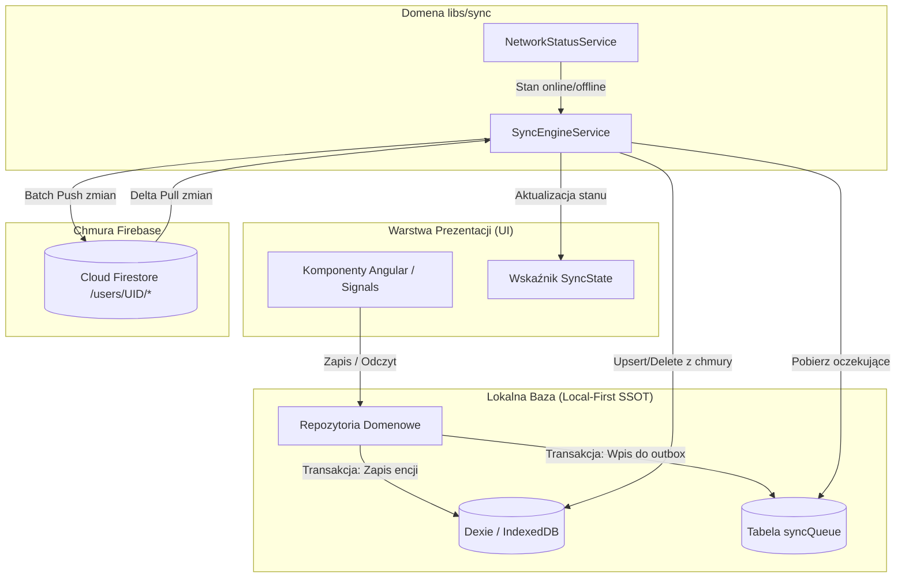
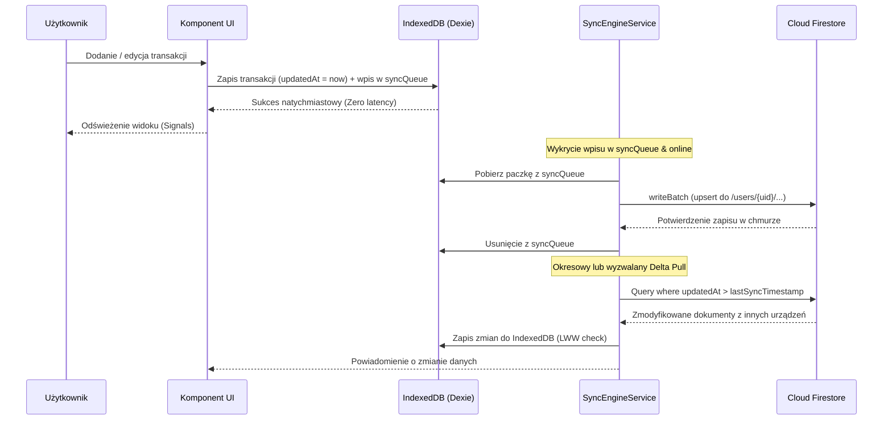

# ADR-004: Hybrydowa synchronizacja IndexedDB (Dexie) z Cloud Firestore (Offline-First)

- **Status:** proposed
- **Date:** 2026-11-13
- **Deciders:** Adam, Antigravity (Architect & BA)
- **Supersedes:** —
- **Superseded by:** —

## Kontekst

Po wdrożeniu Firebase Authentication ([ADR-002](./002-auth-domain-and-firebase-integration.md)) aplikacja Budget Fort posiada tożsamość użytkowników (Google OAuth, Email/Hasło) oraz tryb lokalny (Gość). Wszystkie dane finansowe (transakcje, kategorie, podkategorie, budżety) znajdują się obecnie wyłącznie w lokalnej bazie przeglądarki IndexedDB zarządzanej przez bibliotekę Dexie ([`libs/shared/local-db`](../../libs/shared/local-db)).

Pojawia się potrzeba:
1. Zapewnienia ciągłości danych i kopii zapasowej w chmurze dla zalogowanych użytkowników.
2. Synchronizacji wielourządzeniowej (np. szybki wpis wydatku na telefonie w sklepie $\leftrightarrow$ analiza budżetu na laptopie w domu).
3. Bezwzględnego zachowania natychmiastowej responsywności UI i zasady **Offline-First** (aplikacja nie może czekać na odpowiedź serwera przy zapisie transakcji).
4. Pełnego wsparcia dla trybu Gościa (użytkownicy bez konta nie mogą wysyłać danych do chmury, ale przy późniejszej rejestracji powinni móc scalić lokalne dane z nowym kontem).

## Decyzja

Wybieramy **Model Hybrydowy: Local-First SSOT (Dexie) + Asynchroniczny Background Sync Engine do Cloud Firestore**.

1. **IndexedDB (Dexie) jako lokalne Single Source of Truth (SSOT):**
   - Wszystkie widoki i komponenty nadal czytają i zapisują dane wyłącznie do lokalnego IndexedDB poprzez dotychczasowe serwisy domenowe (`data-access-transaction`, `data-access-budget`).
   - Żadna operacja użytkownika w UI nie jest blokowana przez sieć ani zależna od dostępności Firebase.

2. **Dedykowana domena synchronizacji w monorepo Nx (`libs/sync/`):**
   - `libs/sync/data-access-sync`:
     - `SyncEngineService` – koordynator procesu synchronizacji w tle.
     - `SyncQueueService` – zarządzanie transakcyjną kolejką zdarzeń (`syncQueue` w IndexedDB - Outbox Pattern).
     - `FirestoreSyncService` – adapter komunikacji z Cloud Firestore (wsadowe operacje `writeBatch`, zapytania delta).
     - `NetworkStatusService` – monitorowanie łączności `online`/`offline`.
     - `SyncState` – sygnałowy stan synchronizacji (`status: 'idle' | 'syncing' | 'offline' | 'error'`, `lastSyncedAt`, `pendingChangesCount`).
   - `libs/sync/ui-sync`:
     - Wskaźnik stanu synchronizacji (ikona chmury w pasku nawigacyjnym / profilu) informujący użytkownika o bieżącym statusie.

3. **Model danych i migracja schematu (Dexie v5):**
   - Wszystkie encje otrzymują pola audytowe: `updatedAt: string` (ISO 8601), `isDeleted?: boolean`, `deletedAt?: string`.
   - Usunięcie encji w UI realizowane jest jako **Soft Delete** (`isDeleted = true`), aby zapobiec odtworzeniu usuniętego rekordu przez inne urządzenie.
   - Identyfikatory w tabelach budżetowych zostają zmigrowane z liczb (`number`) na unikalne identyfikatory `string` (UUID lub klucz deterministyczny np. `categoryId`), eliminując ryzyko kolizji kluczy auto-inkrementowanych.
   - Nowa tabela `syncQueue: 'id,store,entityId,createdAt'`.

4. **Strategia spójności i rozwiązywania konfliktów:**
   - **Last-Write-Wins (LWW)** w oparciu o znacznik `updatedAt`.
   - **Delta Sync:** Urządzenie odpytuje Firestore tylko o dokumenty ze znacznikiem `updatedAt > lastSyncTimestamp`, drastycznie ograniczając zużycie darmowych limitów Firebase (Spark Plan).

5. **Obsługa trybu Gościa:**
   - W trybie gościa `SyncEngine` pozostaje uśpiony.
   - Podczas rejestracji lub pierwszego logowania użytkownika z istniejącymi danymi lokalnymi aplikacja oferuje bezkonfliktowy import (merge) lokalnych rekordów do chmury konta użytkownika.

## Rozważane alternatywy

### Alternatywa 1: Bezpośrednie zastąpienie Dexie przez Firestore SDK z włączonym offline cache
- **Opis:** Usunięcie Dexie i odpytywanie wyłącznie SDK Firestore (`persistentLocalCache`).
- **Plusy:**
  - Brak konieczności tworzenia własnego silnika synchronizacji i tabeli kolejki.
- **Minusy:**
  - Wymagałoby całkowitego przepisania wszystkich serwisów danych w projekcie.
  - Ograniczone możliwości zapytań offline w Firestore (brak wsparcia dla złożonych indeksów, filtrowania i agregacji bez wcześniejszego pobrania).
  - Problematyczna obsługa trybu Gościa (wymagałaby Anonymous Auth, który potrzebuje sieci do startu, lub podwójnej implementacji repozytoriów).
- **Dlaczego odrzucono:** Niezgodne z pryncypiami offline-first projektu i zbyt inwazyjne dla istniejącego kodu.

### Alternatywa 2: Zewnętrzne biblioteki synchronizacji (np. Dexie Cloud, RxDB)
- **Opis:** Użycie gotowej platformy synchronizacji.
- **Plusy:**
  - Gotowe mechanizmy konfliktów i websockety.
- **Minusy:**
  - Dexie Cloud to płatna usługa zewnętrzna.
  - Projekt ma już wdrożony Firebase (Auth, Analytics, Hosting) i to w tym ekosystemie powinny znajdować się dane.
- **Dlaczego odrzucono:** Wymóg oparcia rozwiązania na Firebase.

## Konsekwencje

### Pozytywne
- **Maksymalny UX i szybkość:** Aplikacja działa z zerowym opóźnieniem – interakcje użytkownika trafiają bezpośrednio do lokalnej pamięci.
- **Bezpieczeństwo danych:** Zalogowany użytkownik nie straci danych po wyczyszczeniu ciasteczek / IndexedDB na jednym urządzeniu.
- **Optymalizacja kosztów:** Synchronizacja delta minimalizuje transfer i liczbę operacji read/write w Firebase.
- **Czysta separacja domenowa:** Istniejące domeny `transaction` i `budget` nie muszą znać szczegółów Firestore; wiedzą jedynie o Dexie.

### Negatywne / Do monitorowania
- Konieczność przeprowadzenia migracji schematu Dexie (wersja 5) dla istniejących użytkowników (konwersja `CategoryBudget.id` na string).
- Dodatkowa złożoność w obsłudze edge-case'ów: współbieżna edycja offline na dwóch urządzeniach (obsługiwana przez deterministyczny LWW).
- Konieczność okresowego czyszczenia rekordów z flagą `isDeleted` (Garbage Collector).

## Diagramy

### Architektura przepływu danych

### Sekwencja synchronizacji dwukierunkowej

## Powiązane

- [Specyfikacja SDD: `docs/specs/sync/01-firestore-sync.md`](../specs/sync/01-firestore-sync.md)
- [ADR-002: Domena Auth i integracja z Firebase Authentication](./002-auth-domain-and-firebase-integration.md)
- [ADR-003: Eksport i import danych](./003-data-export-import-backup.md)
- [Moduł bazy lokalnej: `libs/shared/local-db`](../../libs/shared/local-db)
