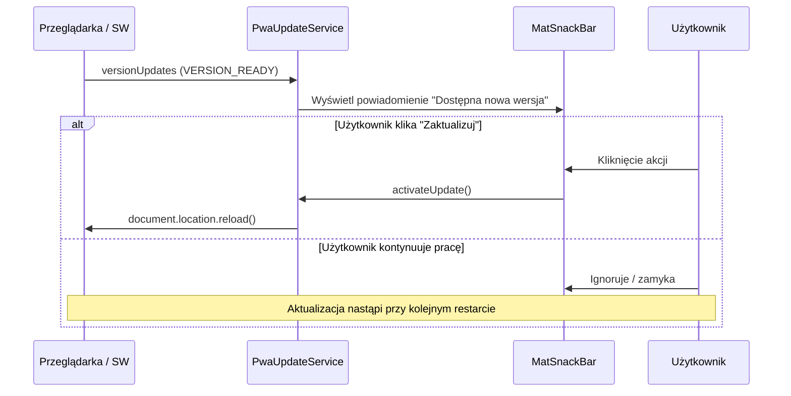

# ADR-006: PWA Update Management & Maintenance Announcements

- **Status:** proposed
- **Date:** 2026-11-15
- **Deciders:** SDLC Orchestrator, Architect, BA
- **Supersedes:** —
- **Superseded by:** —

## Kontekst

Aplikacja **Budget Fort** działa w modelu offline-first jako Progressive Web App (PWA) zbudowana w oparciu o Angular 22.
Wraz z wdrażaniem nowych wydań na Firebase Hosting zachodzi potrzeba:

1. Deterministycznego zarządzania wersjami aplikacji w pamięci podręcznej przeglądarki klienta,
2. Poinformowania użytkownika o dostępności nowej wersji bez przerywania jego pracy (brak natychmiastowego przeładowania i wylogowania),
3. Informowania o planowanych oknach serwisowych w chmurze (np. migracje Firestore, niedostępność synchronizacji) za pomocą banera informacyjnego.

## Decyzja

1. **Wdrożenie `@angular/service-worker`:**
   - Wykorzystujemy oficjalny pakiet `@angular/service-worker` zintegrowany z `@angular/build:application` w Nx.
   - Konfiguracja `ngsw-config.json` buforuje pliki aplikacji w trybie `prefetch` dla assetów aplikacji i `lazy` dla fontów/zasobów zewnętrznych.
   - W konfiguracji `appConfig` rejestrujemy `provideServiceWorker('ngsw-worker.js', { enabled: !isDevMode(), registrationStrategy: 'registerWhenStable:30000' })`.

2. **Obsługa cyklu życia aktualizacji (`PwaUpdateService`):**
   - Serwis nasłuchuje zdarzeń `swUpdate.versionUpdates` filtrując typ `VERSION_READY`.
   - Dodatkowo serwis okresowo (co 6 godzin przy aktywnej aplikacji i połączeniu z siecią) wywołuje `swUpdate.checkForUpdate()`.
   - Po wykryciu nowej wersji aplikacja wyświetla `MatSnackBar` z przyciskiem akcji "Zaktualizuj".
   - Kliknięcie przycisku wywołuje `await swUpdate.activateUpdate()` i `document.location.reload()`.
   - **Brak wylogowania:** Tokeny autoryzacji Firebase i stan IndexedDB pozostają nienaruszone.

3. **Baner prac serwisowych (`MaintenanceBannerComponent`):**
   - Komponent renderowany w shellu aplikacji (`app.html`) nad główną nawigacją.
   - Komunikaty pobierane są ze ścieżki `/system_announcements` w Firestore (lub fallbacku lokalnego w razie braku sieci).
   - Baner filtruje ogłoszenia aktywne wg czasu (`startDate <= now <= endDate`).
   - Użytkownik może ukryć komunikat (`dismissible: true`), co zapisuje `announcement_dismissed_${id}` w `localStorage`.

## Rozważane alternatywy

### Alternatywa 1: Własny Service Worker (Vanilla JS)

- **Plusy:** Pełna kontrola nad każdym bajtem cache.
- **Minusy:** Duży narzut na utrzymanie, ryzyko błędów synchronizacji cache, brak gotowych zdarzeń integracyjnych z Angular Signals/DI.
- **Dlaczego odrzucono:** `@angular/service-worker` jest stabilnym standardem w ekosystemie Angulara, doskonale przetestowanym i wspieranym przez CLI/Nx.

### Alternatywa 2: Automatyczne przeładowanie strony od razu po wykryciu aktualizacji

- **Plusy:** Użytkownik natychmiast ma najnowszą wersję.
- **Minusy:** Może przerwać wprowadzanie transakcji lub konfigurację budżetu przy kasie w sklepie (utrata kontekstu/danych w polach formularza).
- **Dlaczego odrzucono:** Narusza podstawową zasadę UX Budget Fort – użytkownik ma pełną kontrolę i nie może być zaskakiwany przeładowaniem.

## Konsekwencje

### Pozytywne

- Użytkownicy zawsze wiedzą o nowej wersji i sami decydują o momencie odświeżenia.
- Pełna zgodność z architekturą offline-first i PWA.
- Gotowy mechanizm ostrzegania przed nocnymi pracami serwisowymi lub przerwami technicznymi w synchronizacji.

### Negatywne

- Konieczność dbania o kompatybilność wsteczną danych w IndexedDB między kolejnymi wersjami PWA.

## Diagramy

