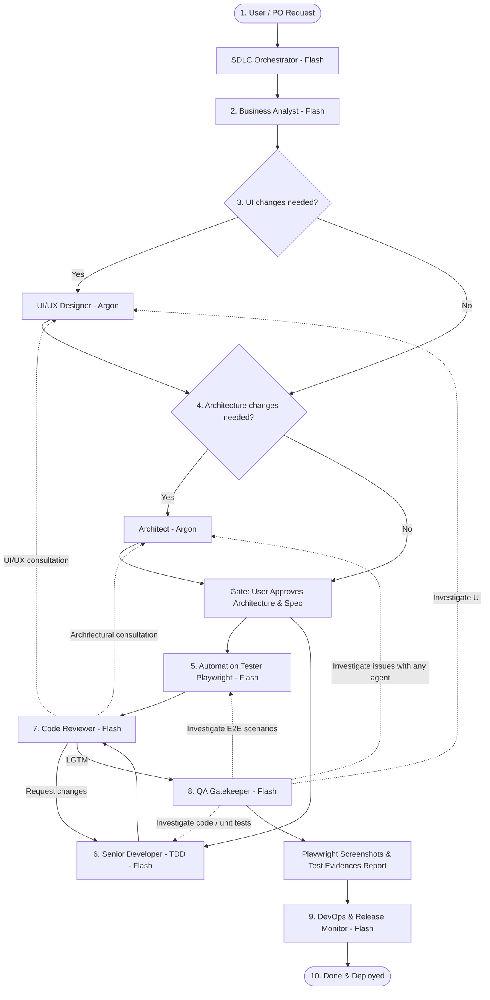

# Spec-Driven Development Workflow

Last updated: 2026-11-10

## Overview

This document defines the Spec-Driven Development (SDD) process for Budget Fort.
The process is orchestrated by the **SDLC Orchestrator** and optimized for agentic workflows — ensuring high architectural rigor, continuous test-driven development (TDD), automated Playwright verification, and clear traceability.

## Roles & Model Assignments

The workflow leverages the following agent roles:

| Role | Model Profile | Responsibility | Trigger |
|------|---------------|----------------|---------|
| **User / Product Owner** | — | Submits tasks, approves specs and architecture | Task initiation / Gate approval |
| **SDLC Orchestrator** | Gemini Flash | Classifies request, selects workflow, dispatches agents | Any incoming request |
| **Business Analyst (BA)** | Gemini Flash | Gathers requirements via drill-down, produces spec draft | Initiated by Orchestrator |
| **UI/UX Designer** *(conditional)* | **Gemini Argon (Pro)** | Designs screen states (loading/empty/error/data), ergonomics, a11y, Anti-UI-Slop | For tasks with UI changes |
| **Architect** *(conditional)* | **Gemini Argon (Pro)** | Designs Nx boundaries, IndexedDB/Dexie schemas, ADRs, service contracts | For structural / data changes |
| **Automation Tester (Playwright)** | Gemini Flash | Creates E2E test scenarios in `apps/budget-fort-e2e/` from spec | After architecture / spec confirmation |
| **Senior Developer (Dev)** | Gemini Flash | TDD implementation (Vitest unit/component tests + code + i18n), updates "Implemented in" | In parallel with or after E2E tests |
| **Code Reviewer** | Gemini Flash | Code quality review, BEM, Signals; consults Architect/Designer; loops back to Dev | After Dev completes implementation |
| **Security & Data Guard** | Gemini Flash | Audits secrets (`scan-secrets.sh`) and offline-first data privacy | Triggered during review / technical tasks |
| **QA Gatekeeper** | Gemini Flash | Runs Quality Gate (`nx affected`), captures Playwright screenshot evidences; investigates failures | After Code Review passes |
| **DevOps & Release Monitor** | Gemini Flash | Verifies CI on GitHub Actions, PWA production build, Firebase deployment | Final deployment step |

## End-to-End SDLC Sequence (New Feature)



## Traceability & Determinism

### Source Code Annotations

Every new code file (`.ts`, `.html`, `.scss`, `.spec.ts`) must include the header:

```typescript
// spec: docs/specs/<domain>/<name>.md
// uc: UC-1, UC-2  (optional – which use cases it implements)
```

Every test (`.spec.ts`) must annotate the Acceptance Criteria it covers:

```typescript
// covers: docs/specs/<domain>/<name>.md#AC-N
it('should add transaction with decimal amount', () => { ... });
```

### Spec "Implemented in" Table

Every spec file must maintain an "Implemented in" section (continuously updated by Dev during implementation):

```markdown
## Implemented in

| File | Date | AC Covered |
|------|------|------------|
| `libs/transaction/feature-transaction/src/lib/.../file.ts` | 2026-11-10 | AC-1, AC-2 |
| `apps/budget-fort-e2e/src/.../file.spec.ts` | 2026-11-10 | AC-1 |
```

## Quality Decision Gates

### Gate 1: Spec Confirmed
- User confirms the requirements ("Approved", "LGTM", "Confirm spec").
- BA marks `docs/specs/<domain>/<name>.md` with status `confirmed`.

### Gate 2: Architecture & Design Confirmed
- User approves technical architecture and UI/UX designs.
- Architect appends the "Architecture & Contracts" section to the spec.
- Architect creates necessary ADRs in `docs/adr/`.
- Developer and Automation Tester proceed to implementation.

### Gate 3: Quality Gate
- `npm exec nx affected -t lint test build e2e` passes cleanly.
- QA Gatekeeper collects Playwright screenshots and test evidences.
- Status: **Ready for Release**.

## Architecture Decision Records (ADRs)

The Architect creates ADRs for decisions that:
- Choose between multiple competing technical solutions
- Have long-term impact on monorepo architecture or data persistence
- Require justification for future maintenance

Template: `docs/adr/adr-template.md`
Location: `docs/adr/<NNN>-<title>.md` (e.g., `docs/adr/001-indexeddb-dexie-schema.md`).

## Related References

- `docs/specs/02-spec-template.md` – Spec template
- `docs/specs/03-spec-glossary.md` – Domain glossary
- `docs/adr/adr-template.md` – ADR template
- `docs/ai/agents/business-analyst.md` – Business Analyst agent
- `docs/ai/02-agent-operating-model.md` – Operating model & dynamic workflows
- `docs/ai/03-testing-quality-gates.md` – Quality gates & testing standards
- `docs/ai/agents/sdlc-orchestrator.md` – SDLC Orchestrator agent
- `docs/ai/agents/architect.md` – Architect agent (Argon)
- `docs/ai/agents/ui-ux-designer.md` – UI/UX Designer agent (Argon)
- `docs/ai/agents/qa-coordinator.md` – QA Gatekeeper & Coordinator
